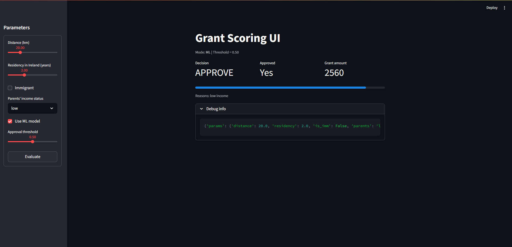
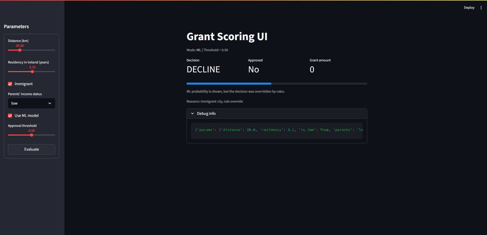

# Grant Scoring: Rules + ML

Two-mode grant scoring: transparent business rules + calibrated logistic regression. Includes scenario generator, CSV evaluation with bucketed metrics, FastAPI API, and Streamlit UI.

All data and the policy below are synthetic.

## Stack
Python 3.11+, FastAPI, scikit-learn, pandas, Streamlit, pytest.

## Rules
Defined once in `app/domain/rules.py`; data generation and evaluation reuse them.
- **Hard declines:** `parents_status=="high"`; `is_immigrant and residency_years_ie>=3.0`.
- **Base:** `parents_status=="low"` → approve; `parents_status=="middle"` → approve iff `distance_km>30`.
- **Amount:** `<=30km → 2560`, else `5697`.

## How the ML mode decides
1. Hard declines always win (`"rule override"` in `reasons`); the ML probability is still returned.
2. Otherwise the decision is `prob >= threshold`. If it differs from the base rule, `reasons` gets `"ml ≥ thr"` or `"ml < thr"`.

The model is trained on labels produced by the same rules (plus 3% label noise), so it approximates the rules rather than adding new information. It is a demo of the rules + ML set-up; real historical decisions would be needed for the model to learn anything beyond the rules.

## Repo
```
app/{api,domain,ml,models,services,ui}
data/{raw,processed}
docs/img
tests
```

## Install
```bash
python -m venv .venv
source .venv/bin/activate        # Windows PowerShell: .venv\Scripts\Activate.ps1
pip install -r requirements.txt
```

## TL;DR
```bash
# generate labeled scenarios (approved + bucket) → data/raw/generated_applicants.csv
python -m app.ml.generate_scenarios

# train → app/models/model.pkl + holdout split → data/processed/holdout.csv
python -m app.ml.train

# evaluate on the holdout → data/processed/{metrics_from_csv.json,preds_from_csv.csv}
python -m app.ml.eval_from_csv

# optional: ML vs rules agreement on a fresh random population
python -m app.ml.eval
```

Every script takes `--help`; for example `python -m app.ml.eval_from_csv --data my.csv` evaluates another CSV (labels and buckets are derived from the rules if the columns are missing).

`python -m app.ml.generate_data` writes an *unlabeled* CSV to `data/raw/unlabeled_applicants.csv`; it does not touch the labeled dataset.

The model path can be overridden with the `GRANT_MODEL_PATH` environment variable (see `.env.example`). The API and UI load the model on first ML request; restart them after retraining.

## API
Run:
```bash
uvicorn app.api.main:app --reload --port 8000
```
OpenAPI: `http://localhost:8000/docs`

Query parameters: `use_ml` (default `true`), `threshold` (default `0.5`, range 0–1). Rules mode (`use_ml=false`) works without a trained model; ML mode returns `503` until `python -m app.ml.train` has been run.

Score example:
```bash
curl -X POST "http://localhost:8000/score?threshold=0.5" \
  -H "Content-Type: application/json" \
  -d '{
    "distance_km": 20,
    "residency_years_ie": 2.0,
    "is_immigrant": true,
    "parents_status": "low"
  }'
```
Response (`prob` depends on the trained model):
```json
{
  "approved": true,
  "decision": "approve",
  "amount": 2560,
  "prob": 0.95,
  "reasons": ["low income"]
}
```

## UI
```bash
streamlit run app/ui/dashboard.py
```
Shows mode (Rules/ML, threshold), decision, probability bar, amount, and reasons.




## Tests
```bash
pytest -q
```
Tests train a small model in a temporary directory, so they do not need `app/models/model.pkl`.

## License
MIT.
